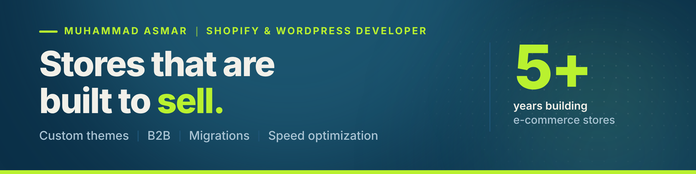
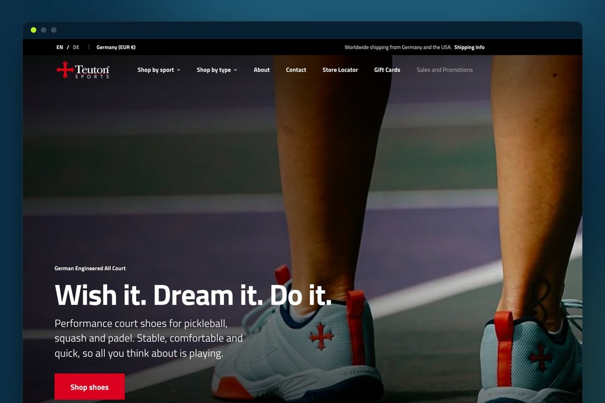
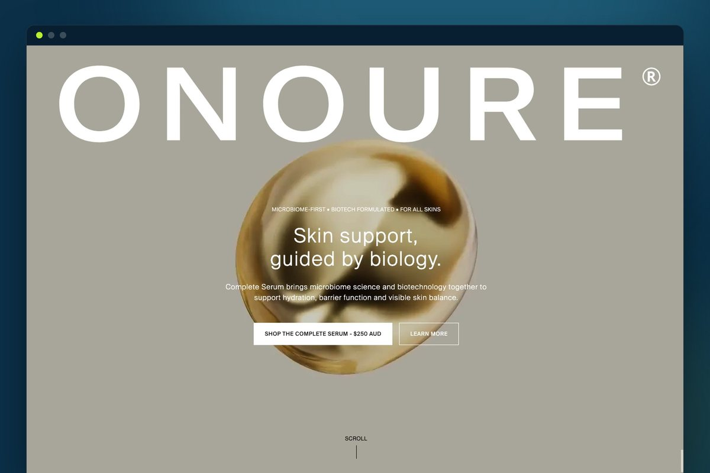
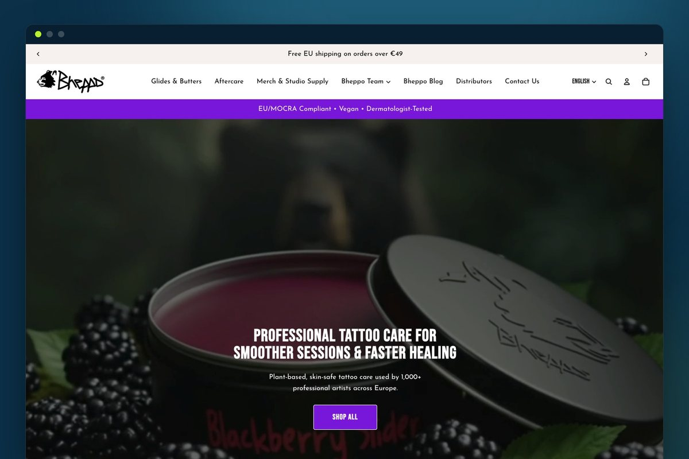
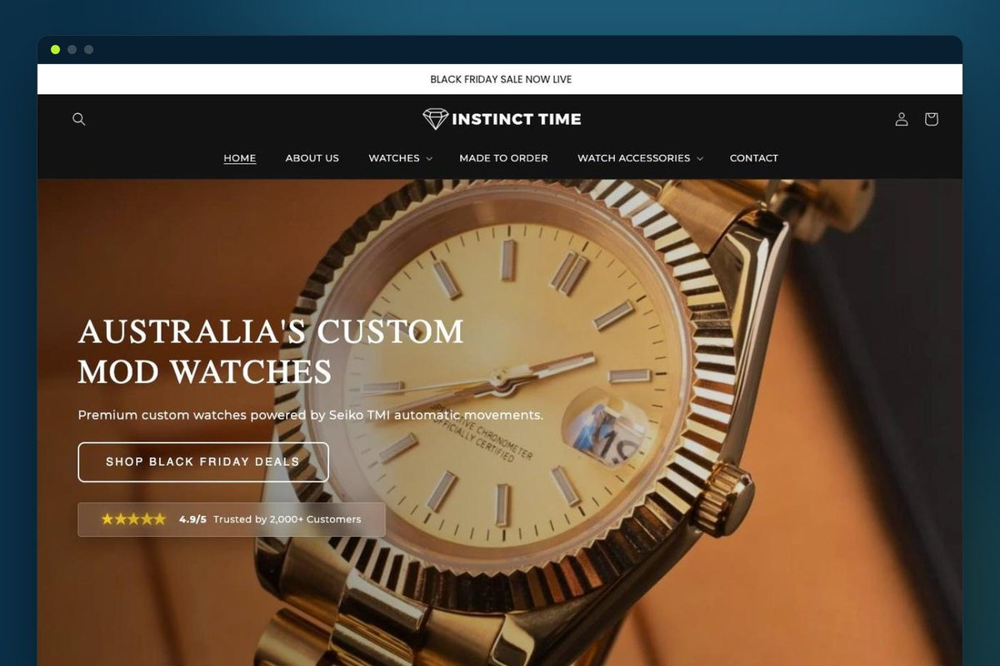
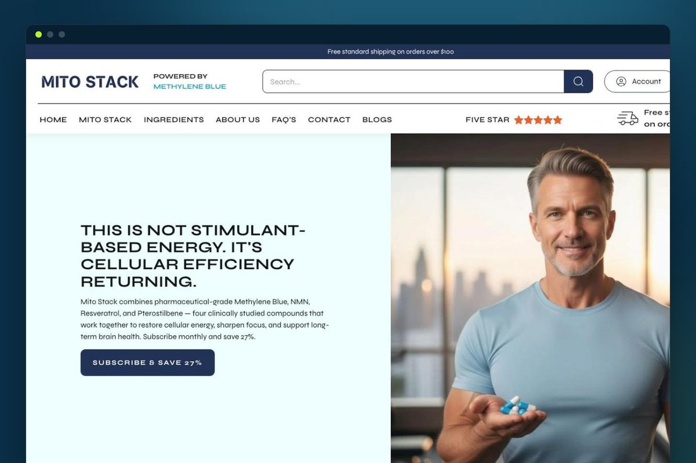
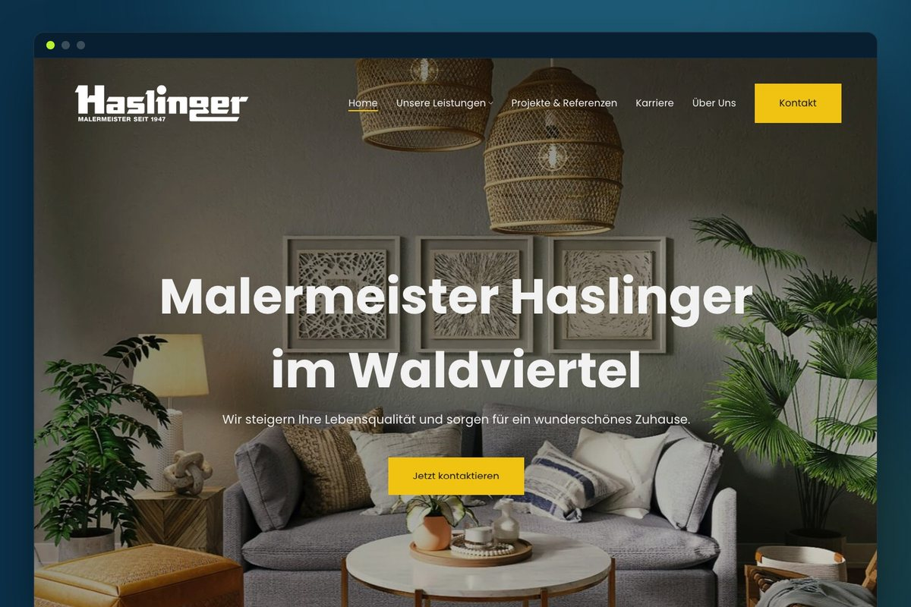
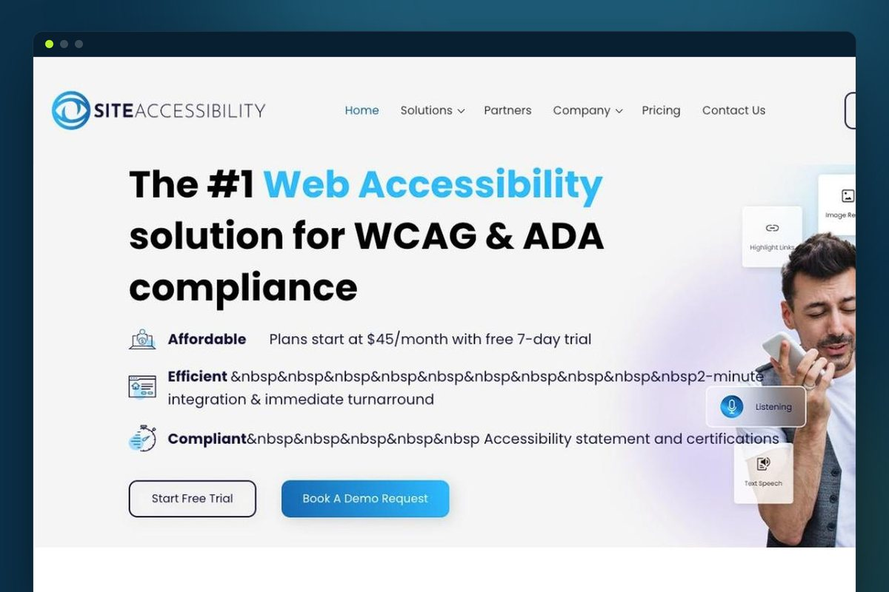

### Hi, I'm Muhammad Asmar

I build fast, conversion-focused e-commerce stores on **Shopify** and **WordPress / WooCommerce**. For 5+ years I've shipped custom themes, store migrations, B2B setups and speed fixes for brands in several countries.

- **Shopify:** custom Liquid themes and OS 2.0 sections, B2B and wholesale setups, migrations from WooCommerce and Etsy, Klaviyo, Meta Pixel and GA4 tracking
- **WordPress / WooCommerce:** custom themes, Elementor and Divi builds, plugin work, full site builds
- **Speed and CRO:** PageSpeed and Core Web Vitals fixes, image and asset optimization, conversion-focused UX
- **Design:** homepage mockups, product page redesigns, design pitches

### Stack

### Recent builds

<table>
  <tr>
    <td width="50%" valign="top">
      
       <b><a href="https://www.teutonsports.com/">Teuton Sports</a></b> (Shopify B2B)
       Custom theme work for a German court-sports brand: B2B quick-order matrix, wholesale quantity rules, location-aware stock, size recommender and club pages.
    </td>
    <td width="50%" valign="top">
      
       <b><a href="https://onoure.com/">Onoure</a></b> (Shopify)
       Biotech skincare brand: landing page, thank-you flow, Klaviyo email sign-up and Meta Pixel tracking.
    </td>
  </tr>
  <tr>
    <td width="50%" valign="top">
      
       <b><a href="https://bheppo.com/">Bheppo</a></b> (Shopify)
       Storefront for a Hamburg-based tattoo-care brand selling glides, butters and aftercare to artists across Europe.
    </td>
    <td width="50%" valign="top">
      
       <b><a href="https://www.instincttime.com/">Instinct Time</a></b> (Shopify)
       Custom mod-watch store with product galleries and custom animations.
    </td>
  </tr>
  <tr>
    <td width="50%" valign="top">
      
       <b><a href="https://mitostack.shop/">MitoStack</a></b> (Shopify)
       Health supplements store with product comparison and subscription billing.
    </td>
    <td width="50%" valign="top">
      
       <b><a href="https://www.haslinger-maler.at/">Haslinger Maler</a></b> (WordPress)
       Website for an Austrian painting and renovation company, with gallery and quote request forms.
    </td>
  </tr>
  <tr>
    <td width="50%" valign="top">
      
       <b><a href="https://siteaccessibility.ai/">SiteAccessibility.ai</a></b> (WordPress)
       AI accessibility platform with WCAG-compliant design and real-time audit tools.
    </td>
    <td width="50%" valign="top"></td>
  </tr>
</table>

### Let's talk

Need a store built, migrated or sped up? Send me a message on **[LinkedIn](https://www.linkedin.com/in/asmar-abbasi/)** with your store URL.
